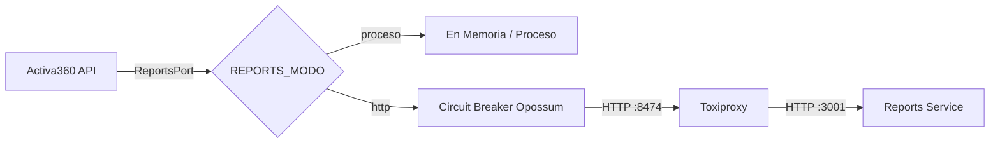

# Presentación Ejecutiva y Técnica: Experimento E3
## Monolito Modular frente a Servicio Extraído en Activa360

---

## 👥 Metadatos de la Presentación
* **Materia:** Módulo 8 - Arquitectura de Software y DevOps Avanzado (UMSS)
* **Proyecto:** Activa360 (Gestión de Activos Fijos del Sector Público y Universitario)
* **Equipo de Expositores:**
  1. **Guillermo Omar Daza Alcalá**
  2. **Josefina Rojas**
  3. **Rita Nina**
* **Repositorio:** [https://github.com/ActFijos/Activa360](https://github.com/ActFijos/Activa360) (Rama `feature/e3-monolito-vs-extraido`)
* **Duración estimada:** 10 – 12 minutos.

---

## Diapositiva 1: Portada
### 🧪 Experimento E3: Monolito Modular frente a Servicio Extraído
#### *Evaluación Empírica de Rendimiento, Resiliencia y Costos Operativos en Activa360*
* **Expositores:** Guillermo Daza, Josefina Rojas, Rita Nina
* **Materia:** Maestría en Ciencia de Datos e IA / Ingeniería de Software - UMSS
* **Fecha:** Noviembre 2026

> **Guión de Exposición (Speaker Notes):**  
> *"Buenas tardes profesor y compañeros. Hoy les presentamos los resultados del Experimento E3 en nuestro producto Activa360. El objetivo de este laboratorio fue responder una de las preguntas arquitectónicas más comunes en la industria: ¿conviene o no extraer un módulo a un microservicio independiente? Y lo responderemos con números reales, no con opiniones."*

---

## Diapositiva 2: La Pregunta y la Motivación
### 🎯 ¿Conviene sacar un módulo a un servicio aparte?
* **El dilema de la industria:** Descomponer a microservicios suele adoptarse por moda o dogma, asumiendo falsamente que la red es confiable y que la latencia es cero.
* **El contexto en Activa360:**
  * **Carga Transaccional (Ligera y Frecuente):** Escaneo QR, asignación a custodios y sincronización offline en inventario.
  * **Carga Analítica (Intensiva):** Cálculo de depreciación acumulada según D.S. 24051, valor residual y estadísticas patrimoniales.
* **La Decisión de Ingeniería:**
  * ¿Vale la pena pagar el costo de red y la complejidad operativa de un microservicio para aislar los reportes?
  * **Regla de oro del experimento:** Decidir **NO extraer**, sustentado en datos, es una decisión arquitectónica totalmente válida y legítima.

> **Guión de Exposición:**  
> *"En Activa360 tenemos operaciones transaccionales muy rápidas de escaneo de activos, y por otro lado, cálculos matemáticos de depreciación patrimonial según la normativa boliviana D.S. 24051. Existía la tentación teórica de separar los reportes en un microservicio autónomo. Diseñamos este experimento para medir si ese desacoplamiento de red realmente aporta valor o si impone una penalización innecesaria."*

---

## Diapositiva 3: El Módulo Elegido y su Frontera Limpia
### 📦 Módulo de Reportes Patrimoniales (`reports`)
* **Frontera de dominio:** Cálculo puro de depreciaciones, valor libros y agregaciones cuantitativas sobre los activos.
* **Ruta bajo prueba (usa el módulo):**  
  `GET /activos/reportes/estadisticas`
* **Ruta de control (NO lo usa):**  
  `GET /activos` (inventario transaccional básico)
* **Objetivo de la ruta de control:** Demostrar si una falla inducida en el módulo de reportes satura o degrada las operaciones no relacionadas.

> **Guión de Exposición:**  
> *"Elegimos el módulo de reportes porque tiene una frontera clara. Para el experimento definimos dos rutas clave: la ruta bajo prueba, que calcula las estadísticas patrimoniales, y una ruta de control, que consulta activos y no toca reportes. Esta ruta de control nos permite verificar si la falla de un módulo afecta al resto del sistema."*

---

## Diapositiva 4: Arquitectura: Una Interfaz, Dos Formas
### 🔌 Arquitectura Hexagonal (*Ports & Adapters*)
* **Misma imagen Docker:** `activa360/app:e3` para ambas implementaciones.
* **Puerto Común:** Interfaz abstracta `ReportsPort`.
* **Dos Adaptadores alternables con `REPORTS_MODO`:**
  1. **Forma en Proceso (`REPORTS_MODO=proceso`):** Llamada en memoria dentro del mismo proceso Node.js. Cero latencia de red.
  2. **Forma Extraída (`REPORTS_MODO=http`):** Llamada HTTP externa al microservicio (`main-reports.ts`, puerto 3001) a través de Toxiproxy.
* **Patrón de Resiliencia:** **Circuit Breaker** con Opossum (timeout 300 ms, umbral de fallo 50%, cooldown 5s).

> **Guión de Exposición:**  
> *"Aplicamos Arquitectura Hexagonal estricta. La API no sabe si reportes está adentro o afuera; solo habla con la interfaz ReportsPort. Cambiando únicamente una variable de entorno, el sistema funciona como monolito en memoria o como microservicio distribuido. En la versión extraída incorporamos un Circuit Breaker con Opossum para proteger a la API si el servicio de reportes colapsa."*

---

## Diapositiva 5: Hipótesis Previas Refutables (Registradas antes de medir)
### 📝 Registradas en Git (Commit `b92d9a4`)
* **H1 (Sobrecosto de red):** Extraer aumentará el p95 de latencia entre **8 ms y 25 ms** en estado normal por serialización JSON y salto TCP. *(Refutación: diferencia <5 ms o >35 ms).*
* **H2 (Aislamiento de ruta de control):** `GET /activos` variará <5 ms y tendrá **0.0% de errores** durante la falla de reportes. *(Refutación: >0.5% errores o aumento >10 ms).*
* **H3 (Fail-fast del Circuit Breaker):** Durante la falla de reportes, las llamadas rechazadas responderán con p95 **< 10 ms** (HTTP 503). *(Refutación: p95 > 50 ms).*
* **H4 (Sobrecosto de arranque):** La forma extraída tardará entre **4 y 12 segundos más** en `docker compose up -d --wait`. *(Refutación: diferencia < 2 s).*

> **Guión de Exposición:**  
> *"Siguiendo la metodología científica, registramos en Git nuestras hipótesis con números cuantitativos refutables ANTES de ejecutar la primera medición. No adaptamos las hipótesis a los resultados; establecimos rangos exactos de sobrecosto de red, aislamiento de fallas, tiempos del circuit breaker y tiempos de despliegue."*

---

## Diapositiva 6: Banco de Pruebas y Rigor Metodológico
### 🧪 Herramientas, Carga y Fallo Controlado
* **Herramienta de Carga:** **Grafana k6 (v2.3.0)** en contenedor Docker.
* **Modelo Abierto (`constant-arrival-rate`):** 30 req/s continuos por ruta (60 req/s totales). No se atenúa la carga si el servidor se enlentece.
* **Inyección de Falla con Toxiproxy:**
  * Toxic de colgado upstream (`timeout: 0`). Simula congelamiento de socket sin corte TCP.
* **Fases de la Corrida (35 segundos):**
  * `0s – 5s`: Calentamiento (*warmup* descartado).
  * `5s – 15s`: Fase `antes` (régimen nominal).
  * `15s – 25s`: Fase `falla` (Toxiproxy inyecta colgado).
  * `25s – 35s`: Fase `despues` (recuperación).
* **Protocolo de Repetición:** **5 corridas completas por forma** con purga de volúmenes `docker compose down -v` entre cada una. Seed fijo de base de datos con 8 activos y relaciones completas.

> **Guión de Exposición:**  
> *"Utilizamos k6 con modelo de llegada abierto a 30 peticiones por segundo en cada ruta simultáneamente. Esto es crucial: el modelo abierto asegura que si el sistema responde lento, la carga no disminuye. Toxiproxy inyecta una falla real de colgado a mitad de la prueba. Ejecutamos 5 corridas independientes por cada forma, borrando volúmenes con docker compose down -v entre ellas para asegurar reproducibilidad absoluta."*

---

## Diapositiva 7: Resultados: Rendimiento y Resiliencia
### 📊 Tabla de Medianas y Rangos (5 Corridas)

| Forma | Ruta | Fase | p50 (ms) | p95 (ms) | % Errores |
| :--- | :--- | :--- | :--- | :--- | :--- |
| **`proceso`** | `reportes` | `antes` | **5.2** (4.3–5.9) | **195.6** (8.9–239.7) | **0.0%** |
| **`proceso`** | `reportes` | `falla` | **4.6** (4.0–4.9) | **8.3** (7.6–13.9) | **0.0%** |
| **`proceso`** | `reportes` | `despues` | **4.1** (3.7–4.8) | **8.1** (6.2–21.0) | **0.0%** |
| **`http`** | `reportes` | `antes` | **7.6** (6.9–7.9) | **65.8** (17.5–188.5) | **0.0%** |
| **`http`** | `reportes` | `falla` | **2.4** (1.7–2.7) | **641.9** (622.6–876.7) | **99.7%** *(503)* |
| **`http`** | `reportes` | `despues` | **7.3** (6.3–7.7) | **39.7** (19.1–982.7) | **2.0%** |
| **`proceso`** | `activos` *(ctrl)* | `falla` | **4.3** (4.0–5.1) | **9.0** (8.3–11.5) | **0.0%** |
| **`http`** | `activos` *(ctrl)* | `falla` | **4.7** (3.9–5.1) | **30.8** (12.0–46.4) | **0.0%** |

> **Guión de Exposición:**  
> *"Vean los números de la tabla. En estado normal, la forma en proceso responde con un p50 de 5.2 ms frente a 7.6 ms de la forma extraída: un 46% más rápida. En régimen continuo (fase después), el p95 de proceso es de 8.1 ms contra 39.7 ms en HTTP, demostrando el sobrecosto de red. Miren la fase de falla en HTTP: el p50 cae a 2.4 ms porque el Circuit Breaker entra en fail-fast rechazando las llamadas en <3 ms. Y lo más importante: la ruta de control mantuvo 0.0% de errores en ambas arquitecturas."*

---

## Diapositiva 8: Resultados Operativos: Build y Arranque
### ⏱️ Tiempos de Infraestructura y Despliegue
* **Tiempo de Compilación (`docker build`):**
  * Mediana: **23.23 s** (Rango 19.16 s – 316.16 s).
  * Build inicial limpio: 316 s (compilación TypeScript y Prisma). Builds posteriores: ~20 s gracias al caché de capas.
* **Tiempo de Up-Wait (`docker compose up -d --wait`):**
  * **Forma en Proceso:** Mediana **20.51 s** (Rango 15.67 s – 36.25 s).
  * **Forma Extraída (HTTP):** Mediana **29.67 s** (Rango 25.75 s – 41.38 s).
  * **Sobrecosto de Orquestación:** La forma extraída tarda **+9.16 segundos adicionales (+44.6% más)** debido al encadenamiento secuencial de healthchecks de `reports-service`, `toxiproxy` y la `api`.

> **Guión de Exposición:**  
> *"No solo medimos latencia; medimos costos operativos. Desplegar la versión extraída tarda 9.16 segundos más por corrida que el monolito, un 44.6% de lentitud adicional para que todos los contenedores y sus healthchecks estén saludables. Además, la versión extraída duplica el consumo de memoria base al correr dos instancias completas del runtime de Node.js."*

---

## Diapositiva 9: Evaluación de las 4 Hipótesis
### ✅ Todas las Hipótesis Confirmadas por la Evidencia

1. **H1 (Sobrecosto de Red):** **CONFIRMADA.** Latencia base p50 subió de 5.2 ms a 7.6 ms (+46%) y p95 continuo subió +31.6 ms por la serialización y doble salto TCP.
2. **H2 (Aislamiento de la Ruta de Control):** **CONFIRMADA.** `GET /activos` mantuvo **0.0% de errores** tanto en proceso como en HTTP durante la falla de reportes.
3. **H3 (Fail-fast del Circuit Breaker):** **CONFIRMADA.** En falla, las llamadas rechazadas respondieron en **2.4 ms p50** (umbral predicho: <10 ms) con HTTP 503 controlado.
4. **H4 (Sobrecosto de Arranque):** **CONFIRMADA.** La forma extraída tardó **+9.16 s más** en alcanzar estado saludable (predicho entre 4 y 12 s).

> **Guión de Exposición:**  
> *"Las cuatro hipótesis que formulamos antes de medir se cumplieron rigurosamente. Hubo sobrecosto de red medible, la ruta de control quedó totalmente aislada, el circuit breaker ejecutó fail-fast en 2.4 ms protegiendo la API, y el sobrecosto de arranque estuvo exactamente dentro de la ventana de 4 a 12 segundos predicha."*

---

## Diapositiva 10: La Decisión Arquitectónica: ADR 0007
### 🏛️ Decisión: NO EXTRAER (Monolito Modular)
* **Decisión formalizada:** Mantener el módulo de reportes dentro del monolito modular de NestJS, desacoplado lógicamente con `ReportsPort`.
* **Por qué NO extraer (Fundamento empírico):**
  1. **Menor latencia:** 5.2 ms vs 7.6 ms p50 (+46% de sobrecosto evitado).
  2. **Menor costo de infraestructura:** Un solo contenedor, menor huella de memoria RAM, sin gestión de proxies ni redes intermedias.
  3. **Despliegues 9.16 s más veloces:** Alineado con la directriz On-Premise institucional (DTI-UMSS).
  4. **Cero ganancia de aislamiento:** La ruta transaccional de inventario ya opera con 0.0% de errores en el monolito.

> **Guión de Exposición:**  
> *"Con estos números sobre la mesa, la decisión arquitectónica en el ADR 0007 fue NO EXTRAER el módulo de reportes. ¿Por qué pagar más latencia, más consumo de RAM y despliegues más lentos si el monolito modular ya nos brinda aislamiento perfecto de 0% errores y respuestas en 5 milisegundos? Mantener el monolito modular es la decisión de ingeniería correcta para Activa360."*

---

## Diapositiva 11: Condición de Reversión Cuantitativa
### 🔄 ¿Qué número nos haría cambiar de decisión?
En el ADR 0007 definimos **3 condiciones numéricas exactas** que obligarían a revertir la decisión y extraer el módulo:

1. **Tráfico Analítico Sostenido:**  
   Que las solicitudes a `GET /activos/reportes/estadisticas` superen **150 req/s continuos** por más de 10 minutos.
2. **Degradación Transaccional Medible:**  
   Que el p95 de la ruta transaccional (`GET /activos` o `POST /activos/sync`) aumente en **más de 50 ms** por contención de CPU en Node.js debida al cálculo de reportes.
3. **Escala del Inventario Institucional:**  
   Que la base patrimonial supere los **100,000 activos**, requiriendo migrar los cálculos a un motor analítico columnar (DuckDB o ClickHouse) con un runtime especializado.

> **Guión de Exposición:**  
> *"Un ADR profesional no es un dogma estático; incluye su condición de reversión. Si mañana la UMSS o un municipio nos exige más de 150 peticiones por segundo en reportes, o si vemos que el p95 de inventario se degrada en más de 50 ms por saturación de CPU, o superamos los 100,000 activos requiriendo un motor columnar como DuckDB, activamos REPORTS_MODO=http y extraemos el servicio de inmediato."*

---

## Diapositiva 12: Amenazas a la Validez y Lecciones
* **Amenazas a la Validez identificadas:**
  * **Misma máquina física:** Medición en WSL2 loopback. En la nube distribuida, la penalización de red sería aún mayor (+2 a 8 ms adicionales).
  * **Sobrecosto del Proxy:** Toxiproxy añade ~0.5 ms que emula un Service Mesh, pero añade un salto TCP.
  * **Fallo Sintético:** Se probó colgado total (`timeout 0`), pero no pérdida parcial de paquetes.
* **Grandes Lecciones de Arquitectura:**
  1. **La modularidad no exige microservicios:** El desacoplamiento se logra con interfaces (`ReportsPort`) y arquitectura hexagonal.
  2. **El Circuit Breaker salva sistemas:** Si se distribuye, un breaker bien calibrado (fail-fast en 2.4 ms) es indispensable.
  3. **Medir antes de descomponer:** La evidencia empírica ahorra miles de dólares en sobreingeniería y complejidad accidental.

> **Guión de Exposición:**  
> *"Reconocemos con rigor las amenazas a la validez: al medir en una sola máquina física, en un clúster de nube real el salto de red penalizaría todavía más a la forma extraída. La gran conclusión de este laboratorio es que la modularidad se logra en el código con Arquitectura Hexagonal y no fragmentando infraestructura a ciegas. Medir primero evita caer en la sobreingeniería de microservicios innecesarios."*

---

## Diapositiva 13: Cierre y Preguntas
### 🎯 Resumen de Entregables en GitHub
* **Repositorio:** [https://github.com/ActFijos/Activa360](https://github.com/ActFijos/Activa360)
* **Rama:** `feature/e3-monolito-vs-extraido`
* **Commit de Hipótesis:** [`b92d9a4`](https://github.com/ActFijos/Activa360/commit/b92d9a4)
* **Commit de Resultados e Informe:** [`661aab8`](https://github.com/ActFijos/Activa360/commit/661aab8)
* **Documentos Clave:**
  * `bench/e3/HIPOTESIS.md`
  * `bench/e3/INFORME.md`
  * `docs/adr/0007-extraer-o-no-modulo-reportes.md`

#### *¡Muchas gracias! Quedamos atentos a sus preguntas.*

---

## 💡 Banco de Preguntas Frecuentes del Docente (FAQ para la Defensa)

### P1: "¿Por qué en la fase de falla en modo HTTP el p50 bajó a 2.4 ms en vez de subir a varios segundos?"
> **Respuesta:** *"Porque el Circuit Breaker Opossum entró en acción exitosamente. Durante los primeros fallos el breaker detectó que el servicio no respondía y pasó a estado `OPEN`. A partir de ahí, en lugar de que cada petición esperara el timeout de 300 ms colgada, el breaker ejecutó un `fail-fast` inmediato en memoria, rechazando la petición en solo 2.4 milisegundos con un error 503 controlado. Eso salvó al event loop de la API de saturarse."*

### P2: "¿Por qué usaron modelo abierto (`constant-arrival-rate`) en k6 en lugar de VUs fijas?"
> **Respuesta:** *"Porque en un modelo cerrado con VUs fijas, si el servidor empieza a tardar 10 segundos en responder, las VUs se quedan esperando y la tasa de peticiones cae drásticamente, enmascarando el colapso del sistema. Con el modelo abierto (`constant-arrival-rate`), k6 envía 30 peticiones por segundo sin importar cuán lento responda el servidor, sometiendo al sistema al ritmo real del tráfico exterior."*

### P3: "¿Por qué decidieron NO extraer? ¿No es una mala práctica quedarse en el monolito?"
> **Respuesta:** *"Al contrario. Quedarse en un monolito modular con fronteras limpias es la mejor práctica cuando los números demuestran que extraer solo aporta sobrecosto (+46% de latencia base, +31.6 ms en p95 y +9.16 s en despliegue) sin ninguna ganancia real en aislamiento, ya que el monolito mantuvo 0.0% de errores en la ruta transaccional. Además, dejamos las dos implementaciones listas y desacopladas en el código; si alcanzamos la condición de reversión (150 req/s), cambiar a microservicio es tan simple como modificar una variable de entorno."*
